# gng

A private hangout app for our DTU friend group. It's like Discord, but it knows where lunch is.

- **Chat**: end-to-end encrypted group chat with replies, tapbacks, photos, files, WhatsApp stickers, iMessage-style Delivered / Read, and plans, exams and notes that post themselves
- **DMs**: encrypted one-to-one chats with anyone you share a gang with, right in the home list next to your gangs
- **Calls**: voice and video, one-to-one or with the gang
- **Notifications**: push notifications you can switch off or mute per chat, with reply from the notification
- **Plans**: one-tap lunch requests, snacks runs, outings, study sessions with RSVPs; a "when is everyone free" finder built from everyone's timetable; a daily lunch board
- **Updates**: the app tells you when a new version is out and installs it in a couple of taps
- **Map**: everyone's avatar on a live campus map, Snap Map style (exact when they go Live, on their pinned spot when they share just the spot)
- **Squad**: who's at the Library / Mic Mac / hostel (spot-only or live for an hour, or go ghost), who's in class, upcoming birthdays with confetti
- **Study**: midsem/endsem radar with a panic meter, and a shared stack of notes, PYQs and links

Android (Kotlin + Jetpack Compose) on a Supabase backend. Multiple gangs with group photos and admin-controlled permissions (who can edit the gang, who can message), invite codes, profile photos, and a **Material You** design that takes its colours from your wallpaper (or a pink-and-teal brand palette), with light and dark themes.

<p>
  
  
  
  
  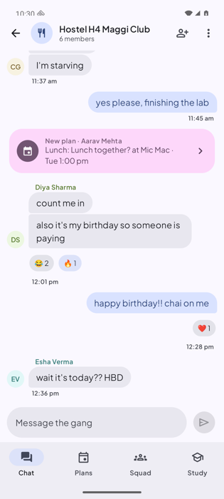
</p>
<p>
  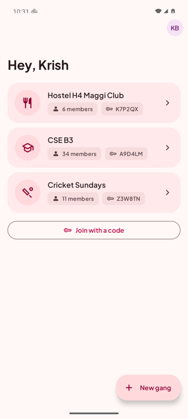
  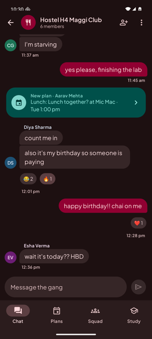
  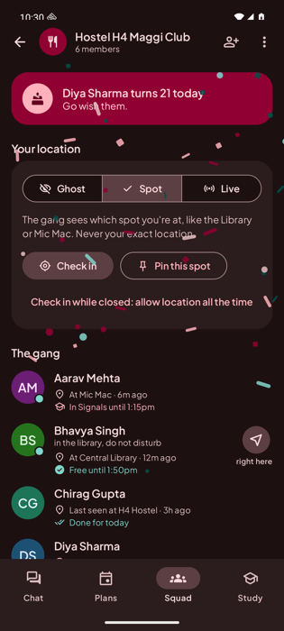
  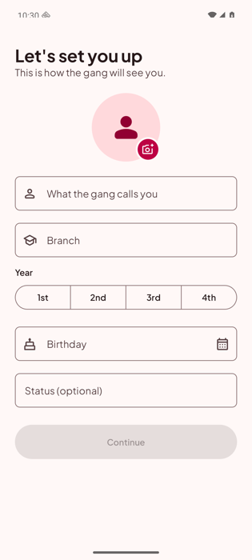
</p>
<p>
  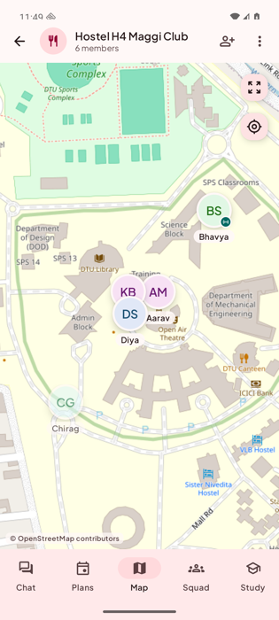
  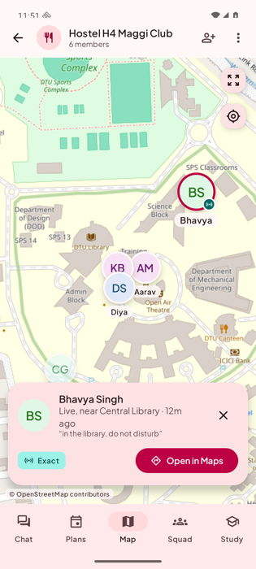
  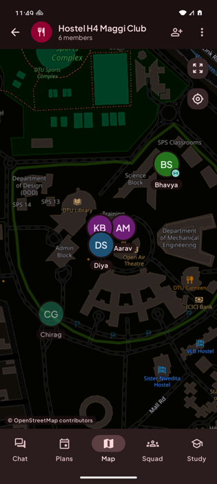
  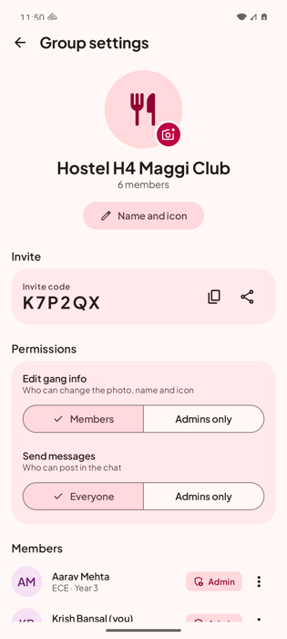
</p>
<p>
  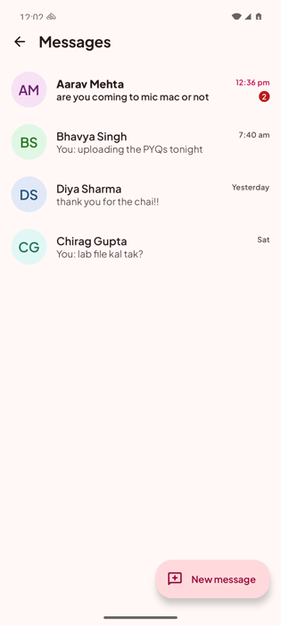
  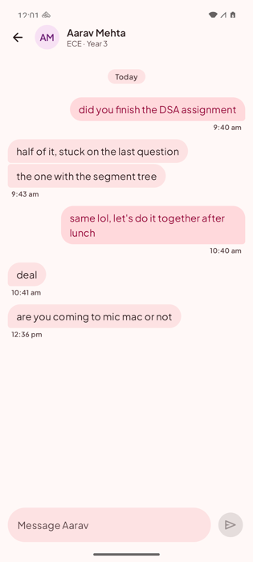
  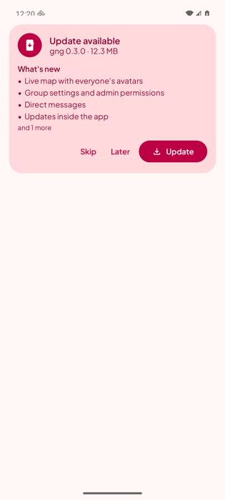
  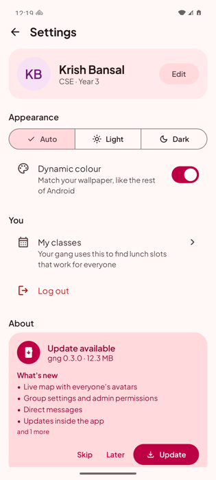
</p>

- **Set it up:** [docs/SETUP.md](docs/SETUP.md)
- **Design system:** [docs/DESIGN.md](docs/DESIGN.md)
- **Product & tech plan, roadmap:** [docs/PLAN.md](docs/PLAN.md)

```
app/        Android app (Compose UI, encryption, calls, push, Supabase repositories, location check-ins)
core/       Pure Kotlin logic with unit tests (zones, timetables, birthdays, exams)
supabase/   Database schema, security policies, RPCs, triggers (migrations 0001 to 0005), and the `push` Edge Function
tools/      Icon and palette generators for the design system
```
