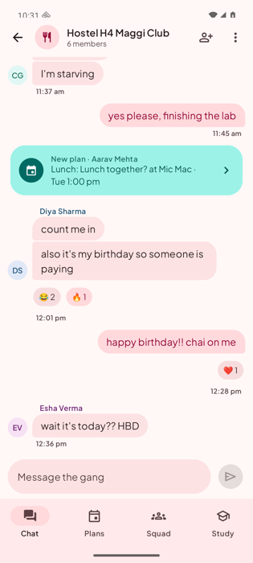
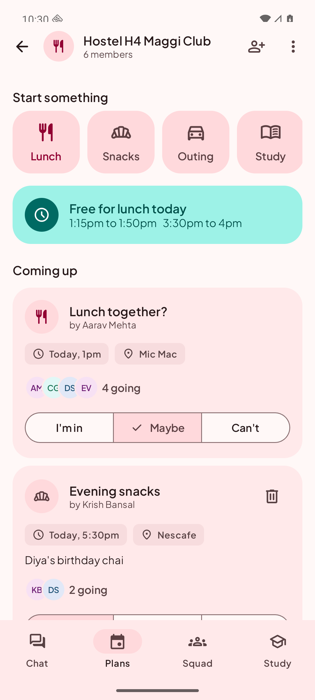
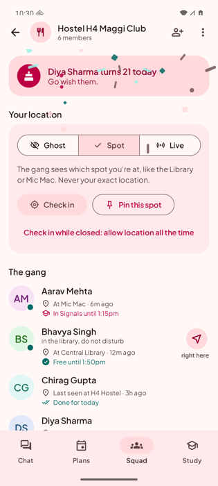
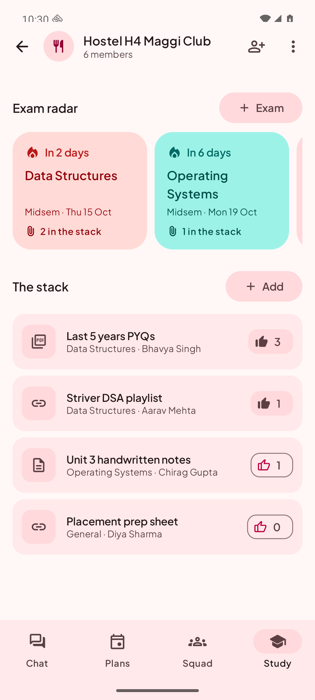

# gng design system

gng follows **Material You (Material 3)**: it should feel native on Android, take on each person's wallpaper
colours, and still have a personality of its own.

   

## Principles

1. **Native first.** Real Material 3 components (navigation bar, segmented buttons, bottom sheets, cards, chips, date and time pickers), not custom lookalikes.
2. **Colour comes from the person.** Dynamic colour is on by default on Android 12+. The brand palette is the fallback and the "off" option.
3. **Icons, not emoji.** Every piece of UI chrome uses a Material Symbols icon. Emoji remain only where they're *content*: the reactions people tap on chat messages and anything they type.
4. **Friends, not a corporation.** Rounder shapes, a friendly typeface, warm copy ("Send it to the gang"), and a bit of motion.
5. **State is visible.** Who's online, who's in class, what's urgent: shown with colour *and* an icon or word, never colour alone.

## Colour

| | |
|---|---|
| Dynamic | `dynamicLightColorScheme` / `dynamicDarkColorScheme` (Android 12+). Settings → Appearance → Dynamic colour |
| Brand fallback | Generated by `tools/gen_palette.py`: Material 3 **Vibrant** scheme from seed `#E8506E` (pink-coral), a rosy secondary, and a **teal tertiary** (`#17A398`) |
| Output | `app/.../ui/theme/BrandColors.kt` (generated, don't edit by hand) |

Role usage, so the app looks right under *any* palette (including a wallpaper that gives a blue or green theme):

- `primary` / `primaryContainer`: your own chat bubbles, the main action, gang icons, the "today" states
- `secondaryContainer`: quick-action tiles, selected segments and chips
- `tertiary` family: positive state ("free", "online", "going") and the plan event cards
- `errorContainer`: exams that are 0 to 2 days away
- `surfaceContainer*`: cards (`surfaceContainer`), nested wells and chips (`surfaceContainerHigh/Highest`), input bar

Regenerate: `pip install materialyoucolor && python3 tools/gen_palette.py [#RRGGBB]`.

## Typography

**Plus Jakarta Sans** (SIL OFL), a single variable font file (`res/font/plus_jakarta_sans.ttf`) covering weights 300 to 800.
The full Material 3 type scale is mapped in `ui/theme/Type.kt`, with slightly heavier headings than stock.

## Shape

`ui/theme/Shape.kt`: 8, 12, 16, 24 and 32 dp. Cards use `large` (24), inputs and small tiles `medium`/`small`, avatars and icon badges are circles.

## Icons

Material Symbols **Rounded**, weight 400, converted to Android vector drawables and bundled (about 100 icons, not the 10 MB icon library).

- The list lives in `tools/icons.txt`; `python3 tools/fetch_icons.py` downloads and converts them and regenerates `GngIcons.kt`.
- Add `+` after a name to also generate the filled variant (`ic_<name>_fill`), used for selected navigation items.
- Use them through `GngIcon(GngIcons.X, contentDescription)`.
- Gangs, spots and meals are stored as an **icon key** in the existing `emoji` database columns (`groups`, `restaurant`, `local_library`...). The choices are in `ui/icons/IconChoices.kt`; unknown or legacy values fall back to a default icon.

Material Symbols are Apache 2.0 licensed.

## Avatars

`Avatar(name, photoUrl)`: the profile photo if there is one, otherwise initials on a tonal colour. The colour is picked per person from eight hues **rotated from the active scheme's container colour**, so avatars always harmonise with the current palette. Photos are centre-cropped to a 512 px square JPEG on the phone and uploaded to the `avatars` bucket.

## Components (`ui/components`)

| | |
|---|---|
| `GngIcon`, `TonalIcon` | icons, and an icon on a tonal shape for list leading content |
| `Avatar`, `StatusAvatar`, `AvatarStack` | people, with an online dot, and overlapping avatars for attendee lists |
| `SegmentedChoice` | Material segmented buttons with a check on the selected segment |
| `InfoChip`, `SectionHeader`, `EmptyState` | small labels, section titles, empty screens with an icon |
| `GngSheet`, `IconPicker` | the bottom sheet every create/edit form uses, and a selectable icon grid |
| `GngDatePickerDialog`, `GngTimePickerDialog` | Material 3 pickers |
| `Confetti` | birthday confetti in the current accent colours |
| `MessageEffect` + `LocalSnackbar` | errors and notices appear in a snackbar |

## Motion

Screens fade in with a short slide and fade out quickly (`MainNav.kt`); tabs cross-fade; the splash screen uses the gng mark; selection changes use the standard Material animations. Birthdays trigger confetti once.

## App icon

An adaptive icon: the gng mark (a chat bubble with three dots, the dots cut out so the background shows through) on pink, plus a **monochrome layer** so it takes the wallpaper colours on Android 13+ when themed icons are on.

## Reviewing the design

The debug build contains a **gallery** that renders every screen with sample data in light, dark and dynamic colour. See "Run on an emulator" in [SETUP.md](SETUP.md).

## Accessibility

- Text and containers come from Material colour roles, which are built to meet contrast requirements, including dynamic palettes.
- Icon-only buttons carry content descriptions; decorative icons use `null`.
- Touch targets are at least 48 dp (Material components handle this).
- Status is never colour-only: online dots are paired with text, urgency has an icon and a label.
